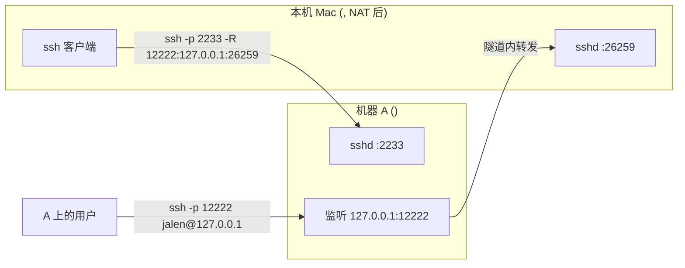

# 反向 SSH 隧道使用说明

让**机器 A(<JUMP_HOST>)能 SSH 回这台 Mac**。

因为这台 Mac 在 NAT 后面(`<MAC_LAN_IP>`),A 无法主动连进来 —— 实测:A 的 ping 100% 丢包、TCP 22 连接失败、traceroute 全是 `*`。所以方案是**由 Mac 主动连出**,在 A 上开一个监听端口,把连接反向送回 Mac 的 sshd。

配套脚本:

- [`revtunnel.sh`](./revtunnel.sh) —— 反向隧道本体(保活心跳 + launchd 自愈)
- [`macos-sshd-extra-port.sh`](./macos-sshd-extra-port.sh) —— 让 macOS 的 sshd **额外监听 `26259`**(保留 22)

> **状态:已落地并端到端验证通过**(2026-09-25)。详见 §12。

---

## 1. 它解决什么问题

| 问题 | 默认 `ssh -R` 的表现 | 本方案的处理 |
|---|---|---|
| 空闲假死(NAT 映射过期) | 连接看着还在、实际已断,**最长 2 小时**才发现 | 每 30s 心跳,最长 **90 秒**发现并退出 |
| 进程死了没人拉起 | 断了就断了 | launchd `KeepAlive` 自动重连(最小间隔 10s) |
| 远端端口被占用 | 「连上了但没转发」还赖着不走 | `ExitOnForwardFailure=yes` 立即退出并重试 |
| 服务端空闲踢人 | —— | 已确认 **不存在**(A 的 `ClientAliveInterval=0`) |

实测到的本环境时间参数:

| 项目 | 值 | 说明 |
|---|---|---|
| A 的 `sshd ClientAliveInterval` | `0` | 服务器不心跳、不踢空闲连接 |
| A 的 `tcp_keepalive_time` | `7200` s | 内核层 2 小时后才探测 ← 假死窗口的来源 |
| Mac 的 `ServerAliveInterval` | 未配置 | 默认一个包都不发 |
| 本方案设置 | `30s × 3` | 90 秒内判定死亡并重连 |

---

## 2. 端口与架构

### 三个端口别混淆

| 变量 | 默认值 | 谁在监听 | 谁去连 |
|---|---|---|---|
| `RT_PORT` | `2233` | 机器 A 的 sshd | Mac 主动连出去 |
| `RT_REMOTE_PORT` | `12222` | **机器 A**(隧道开的门) | 你在 A 上 `ssh -p 12222 …` |
| `RT_LOCAL_PORT` | `26259` | **这台 Mac 的 sshd** | 隧道内部回连 |

对外(在 A 上)用的端口是 `12222`,不是 22;Mac 侧的 `26259` 默认只绑 loopback。

### 架构



文字版:

1. Mac 主动连 A 的 `2233` 端口(这条方向的连通性已存在)。
2. Mac 请求 A 在本机 `127.0.0.1:12222` 上开一个监听。
3. 任何连到 `12222` 的流量,都通过这条 SSH 连接送回 **Mac**,由 Mac 去连 `127.0.0.1:26259`。
4. `ServerAliveInterval` 持续保活,`launchd` 负责掉线重连。

> `-R` 里的目标地址 `127.0.0.1:26259` 是由 **Mac 这一端**去连接的,指的是 Mac 自己的 sshd,不是 A 的。

---

## 3. 快速开始

```bash
# 0. 确保脚本可执行
chmod +x revtunnel.sh macos-sshd-extra-port.sh

# 1. 让 Mac 的 sshd 额外监听 26259(保留 22;需要 sudo)
#    ⚠ 环境变量必须写在 sudo 后面,否则会被 sudo 丢弃
sudo SSHD_EXTRA_BIND=127.0.0.1 bash macos-sshd-extra-port.sh install
bash macos-sshd-extra-port.sh verify      # 确认 26259 真的能握手

# 2. 体检:确认 sshd、防火墙、睡眠、认证、端口都正常
./revtunnel.sh doctor

# 3. 把 A 的公钥装进 Mac 的 authorized_keys(让 A 能免密登录本机)
./revtunnel.sh setup-auth

# 4. 安装 launchd 常驻服务(开机/登录自启 + 掉线自愈)
./revtunnel.sh install

# 5. 从 A 侧真实走一遍隧道,验证链路与认证
./revtunnel.sh verify
```

完成后,在**机器 A** 上:

```bash
ssh -p 12222 jalen@127.0.0.1
```

想先看安装会改什么、不落地,用 `./revtunnel.sh install --dry-run`(只打印 plist 和命令)。

前置条件:

- Mac 上「系统设置 → 通用 → 共享 → **远程登录**」必须打开(脚本 `doctor` 会检查)。
- Mac 侧的 `26259` 必须真的有 sshd 在监听 —— 见 §6,不装的话隧道会连不上。
- Mac → A 的 `2233` 端口免密登录要可用(现已可用);否则先 `ssh-copy-id -p 2233 <JUMP_USER>@<JUMP_HOST>`。
- **脚本所在目录不能是 `~/Documents`、`~/Desktop`、`~/Downloads`** —— 见 §6.5。
  当前脚本就在 `~/Documents` 下,已经通过运行时副本机制绕开,但你改完代码**必须重新 `install`**。
- 想改回系统默认的 22:`RT_LOCAL_PORT=22 ./revtunnel.sh install`。

---

## 4. 命令参考

### `revtunnel.sh`

| 命令 | 作用 |
|---|---|
| `doctor` | 上线前体检:本机 sshd、防火墙、睡眠、网络、双向认证、服务状态 |
| `setup-auth` | 取 A 的公钥(没有则自动生成)并写入 Mac 的 `~/.ssh/authorized_keys` |
| `install [--dry-run]` | 生成 plist、安装并启动 launchd 服务;`--dry-run` 只打印不落地 |
| `uninstall` | 停止并删除 launchd 服务(日志保留) |
| `start` | 启动已安装的服务 |
| `stop` | 停止服务(**本次登录会话内**;重新登录或 `start` 会恢复) |
| `restart` | 重启服务(`kickstart -k`) |
| `status` | 查看 launchd 状态、Mac 侧 sshd、A 侧端口监听、日志尾部 |
| `verify` | 从 A 侧经隧道连一次本机,区分「链路通」和「认证也通」 |
| `run [-i]` | 前台运行隧道,用于调试;`-i` 允许交互输密码,`Ctrl-C` 结束 |
| `logs [-n N] [-f]` | 查看日志,默认 40 行;`-f` 持续跟踪 |
| `config` | 打印当前生效的全部配置 |
| `help` | 帮助 |

### `macos-sshd-extra-port.sh`

| 命令 | 作用 |
|---|---|
| `sudo bash macos-sshd-extra-port.sh install` | 额外开放 `26259`,立即生效(需要 sudo) |
| `sudo bash macos-sshd-extra-port.sh uninstall` | 关闭并删除该监听(需要 sudo) |
| `bash macos-sshd-extra-port.sh status` | 查看端口与服务状态 |
| `bash macos-sshd-extra-port.sh verify` | 对 `26259` 和 `22` 各做一次 SSH 握手 |

示例:

```bash
./revtunnel.sh logs -f                        # 实时看隧道日志
RT_REMOTE_PORT=13389 ./revtunnel.sh install   # 换 A 侧门牌号重装
sudo SSHD_EXTRA_PORT=22222 bash macos-sshd-extra-port.sh install   # 换 Mac 侧端口
./revtunnel.sh status                         # 一看便知活着没
```

---

## 5. 配置项

全部通过**环境变量**覆盖,`install` 时会把当前值写进 plist(所以改完要重新 `install`)。

| 变量 | 默认值 | 说明 |
|---|---|---|
| `RT_HOST` | `<JUMP_HOST>` | 机器 A 地址 |
| `RT_PORT` | `2233` | 机器 A 的 sshd 端口 |
| `RT_USER` | `<JUMP_USER>` | 机器 A 上的登录用户(占位符) |
| `RT_REMOTE_BIND` | `127.0.0.1` | 隧道在 A 上绑定的地址 |
| `RT_REMOTE_PORT` | `12222` | 隧道在 A 上监听的端口 |
| `RT_LOCAL_HOST` | `127.0.0.1` | 目标地址(由 **Mac 侧**解析,默认即本机) |
| `RT_LOCAL_PORT` | **`26259`** | 目标端口(Mac 上 sshd 的监听端口) |
| `RT_IDENTITY` | 空 | 私钥路径,留空用 ssh 默认查找 |
| `RT_BATCH` | `yes` | `yes`=仅密钥认证(launchd 必须);`no`=允许交互输密码 |
| `RT_LABEL` | `com.jalen.revtunnel` | launchd 服务标识 |
| `RT_ALIVE_INTERVAL` | `30` | 心跳间隔(秒) |
| `RT_ALIVE_COUNT_MAX` | `3` | 连续丢几个心跳判定死亡 |
| `RT_CONNECT_TIMEOUT` | `10` | 连接超时(秒) |
| `RT_THROTTLE` | `10` | launchd 重启最小间隔(秒),防疯狂重启 |
| `RT_LOG` | `~/Library/Logs/revtunnel.log` | 日志路径 |
| `RT_LOG_MAX_BYTES` | `5242880` | 超过 5MB 时滚动为 `.log.1` |
| `RT_RUN_DIR` | `~/.local/libexec/revtunnel` | TCC 安全目录,存放运行时副本与包装器 |

`macos-sshd-extra-port.sh` 的变量(**必须写在 `sudo` 之后**):

| 变量 | 默认值 | 说明 |
|---|---|---|
| `SSHD_EXTRA_PORT` | `26259` | 要额外开放的端口 |
| `SSHD_EXTRA_BIND` | 空(所有网卡) | 设为 `127.0.0.1` 则只允许本机回连,更安全 |
| `SSHD_EXTRA_LABEL` | `local.sshd-extra-port` | launchd 服务标识 |

生成的 plist:

- 隧道:`~/Library/LaunchAgents/com.jalen.revtunnel.plist`
- 额外端口:`/Library/LaunchDaemons/local.sshd-extra-port.plist`

运行时的副本与包装器(§6.5 会解释为什么需要):

- `~/.local/libexec/revtunnel/launch.sh` —— launchd 实际执行的包装器
- `~/.local/libexec/revtunnel/revtunnel.sh` —— launchd 实际运行的脚本副本

```bash
# 直接看已安装服务在 launchd 里的完整定义
launchctl print gui/$(id -u)/com.jalen.revtunnel
launchctl print system/local.sshd-extra-port
```

---

## 6. 让 Mac 的 sshd 额外监听 26259(macOS 专属)

### 背景:macOS 默认走 launchd 的 socket 激活

macOS 默认的 sshd 不是自己 bind 端口的,而是由 launchd 以 **socket 激活**方式启动:

```
/System/Library/LaunchDaemons/ssh.plist
  Program                            = /usr/libexec/sshd-keygen-wrapper
  Sockets → Listeners → SockServiceName = ssh     ← 端口由这里决定
  (文件里还写着 Disabled = true,但 22 确实在监听 —— 说明「远程登录」开关
   是通过 launchd 的 enabled/disabled 覆盖库生效的,不是改这个文件)
```

在这种 inetd 风格模式下(套接字由 launchd 建好再交给 sshd),**`sshd_config` 里的 `Port` / `ListenAddress` 会被忽略**。而 `/System/Library/LaunchDaemons/` 处于 SIP 保护范围,不适合直接改。

### ⚠ 为什么不能"照抄 Apple 的 plist,只把 ssh 换成端口号"

这是本项目踩过、**必须记住**的一个坑。直觉做法是复制 Apple 的写法、把 `SockServiceName` 从 `ssh` 换成 `26259`,但这样 **在 macOS 上永远起不来监听**:

launchd 会拿这个字符串去调 `getaddrinfo(host, serv)`,而 **macOS 的 `getaddrinfo` 不接受任意数字端口串**:

```
$ getaddrinfo("", "26259")           ->  EAI_SERVICE (8) nodename nor servname provided
$ getaddrinfo("", "ssh")             ->  0 (OK)
$ getaddrinfo("127.0.0.1", "26259")  ->  EAI_SERVICE (8)     ← 给了绑定地址也一样失败
```

实测到的 launchd 日志:

```
launchd[1]: [system/local.sshd-extra-port - Listeners:]
            getaddrinfo(3): 8: nodename nor servname provided, or not known
```

表现为:服务"已加载"、`launchctl print` 里能看到 `sockets` 段,但 `error = 3`、端口**永远不 LISTEN**。Apple 自己写 `ssh` 能 work,正因为它是 `/etc/services` 里注册过的服务名;而 `/etc/services` 受 SIP 保护,不该为了这个去改。

### 本脚本的做法:让 sshd 自己监听

不碰 launchd 的 socket 激活,改为由 launchd 保活一个**前台 sshd**:

```
/usr/sbin/sshd -D -p 26259 -o ListenAddress=127.0.0.1
```

关键是把端口/地址写在**命令行**上,因为 `/etc/ssh/sshd_config` 里已有生效的 `Port 22` 和 `ListenAddress 0.0.0.0`。按 `man sshd`:

- `-p`:`Ports specified in the configuration file with the Port option are ignored when a command-line port is specified.`
- `-o`:`Ports specified using the ListenAddress option override command-line ports.`

所以 `-p` 覆盖 config 的 `Port`,`-o ListenAddress=` 覆盖 config 的 `ListenAddress`,**22 端口完全不受影响**(仍由系统自带的 `com.openssh.sshd` 负责)。

> 注:`sshd -p` 只接受**纯数字端口**,不支持 `host:port`(`sshd -p 127.0.0.1:26259` 会报 `Bad port number`),所以绑定地址必须用 `-o ListenAddress=` 单独给。

```bash
# 安装 / 卸载 / 查看
# ⚠ 环境变量必须写在 sudo 后面,否则 sudo 会把它丢掉
sudo SSHD_EXTRA_BIND=127.0.0.1 bash macos-sshd-extra-port.sh install
sudo bash macos-sshd-extra-port.sh uninstall
bash macos-sshd-extra-port.sh status

# 想监听所有网卡(不推荐):去掉 SSHD_EXTRA_BIND
# 换端口:sudo SSHD_EXTRA_PORT=22222 bash macos-sshd-extra-port.sh install
```

脚本还会把本次生效的配置写到 `/var/run/local.sshd-extra-port.conf`,这样 `status` / `verify` 在非 root、未导出环境变量时也能显示正确的端口与绑定地址。

### 落地后的验证

```bash
netstat -an | grep -E "\.(22|26259) " | grep -i listen   # 两个端口都应在 LISTEN
bash macos-sshd-extra-port.sh verify                     # 两个端口都能 SSH 握手
```

### 回滚

`uninstall` 会停止服务、删除 plist 并释放端口,22 完全不受影响。若只想临时停:

```bash
sudo launchctl bootout system/local.sshd-extra-port   # 临时停,重启后自动恢复
```

---

## 6.5 ⚠ 脚本不能放在 `~/Documents` 下(已用副本机制解决)

这是本项目第二个必须知道的坑,现象极具误导性:隧道服务**装得上、不报错、但立刻退出**,日志里反复出现:

```
/bin/bash: /Users/.../Documents/.../revtunnel.sh: Operation not permitted
```

**这不是 Unix 权限问题** —— 路径上每一级都有 `x` 位、脚本也是 `755`。真因是 **macOS TCC 隐私保护**:

```
tccd: AUTHREQ_CTX: function=TCCAccessRequest,
      service=kTCCServiceSystemPolicyDocumentsFolder, preflight=yes
tccd: Platform binary prompting is 'Deny' because: is Platform Binary
launchd: Successfully spawned bash[34960] → exited due to exit(126), ran for 75ms
```

三点结论:

1. `~/Documents`、`~/Desktop`、`~/Downloads` 受 TCC 保护,**任何进程**读其中文件都会被拦 —— 与"谁去读"无关。
2. 你在终端里手工跑没问题,因为**终端这个 App 早已被授权**;而 launchd 启动的 job 没有 UI 可弹窗。
3. `/bin/bash` 是 platform binary,系统**明确不给它弹窗授权的机会**(直接 Deny)。所以只能绕开,无法"授权解决"。

因此 `revtunnel.sh install` 会自动复制一份到 TCC 安全目录,并生成包装器:

```
~/.local/libexec/revtunnel/launch.sh        ← plist 指向它
~/.local/libexec/revtunnel/revtunnel.sh     ← 真正被执行的副本(不读源目录)
```

**唯一代价:改完代码或配置后,必须重新 `./revtunnel.sh install` 才会生效**(它负责刷新副本)。
`./revtunnel.sh doctor` 的 `[5]` 段会明确报出这一点。

> 如果将来把脚本搬到不受保护的位置(如 `~/projects/`、`~/bin/`、`/usr/local/libexec/`),
> 这套副本机制依然兼容,只是不再必要。

## 7. 从 A 侧访问本机的几种姿势

```bash
# 1. 直接在 A 上登录(最常用)
ssh -p 12222 jalen@127.0.0.1

# 2. 在 A 上开一个交互式会话后,再跳到本机
ssh -p 12222 jalen@127.0.0.1 -t 'tmux new -A -s mac'

# 3. 从本机带上端口转发,一次性做文件传输
scp -P 12222 ./本地文件 jalen@127.0.0.1:/tmp/

# 4. 让 A 之外的人也能用:需要在 A 的 sshd_config 里
#    GatewayPorts clientspecified
#    然后 RT_REMOTE_BIND=0.0.0.0 ./revtunnel.sh install
#    ⚠️ 这会把 Mac 的 26259 暴露给整个 <JUMP_LAN>/24,默认不要开
```

---

## 8. 工作原理:为什么这几个参数一个都不能少

```bash
ssh -N -R 127.0.0.1:12222:127.0.0.1:26259 <JUMP_USER>@<JUMP_HOST> -p 2233 \
  -o ServerAliveInterval=30 \
  -o ServerAliveCountMax=3 \
  -o TCPKeepAlive=yes \
  -o ExitOnForwardFailure=yes \
  -o ConnectTimeout=10
```

- **`ServerAliveInterval=30` + `ServerAliveCountMax=3`**
  SSH 协议层心跳。作用有两个:①每个包都在刷新沿途 NAT 的会话映射,从根上避免映射过期;②真正验证端到端是否活着(比 TCP keepalive 强,TCP 层只是内核探测,且本机默认 2 小时才动)。90 秒收不到回应就让 ssh 退出。
- **`ExitOnForwardFailure=yes`**
  远端端口被占用时直接退出,把失败暴露给 launchd,而不是留一个「连上了但没转发」的僵尸连接。
- **launchd `KeepAlive=true` + `ThrottleInterval=10`**
  上面的参数负责**让死掉的 ssh 尽快退出**,launchd 负责**立刻把它拉起来**。

> 两者是配套的:只做保活不加心跳 → 假死时进程不退出,保活也没用;只加心跳不做保活 → 断线后没人重连。
> 脚本用 `exec ssh`,所以 launchd 直接跟踪 ssh 进程本身,状态和真实连接严格一致。

---

## 9. 故障排查

| 症状 | 原因 / 处理 |
|---|---|
| `doctor` 报 `26259` 未监听 | 跑 `sudo SSHD_EXTRA_BIND=127.0.0.1 bash macos-sshd-extra-port.sh install`;注意改 macOS `sshd_config` 的 `Port` 是无效的 |
| `status` 显示 A 上 `12222` 未监听 | 看 `logs -n 50`。常见是认证失败(公钥没配)或端口被占,换 `RT_REMOTE_PORT` 重装 |
| `verify` 报 `Permission denied` | **链路是通的**,只差认证。执行 `setup-auth` |
| 隧道连上但立刻断开 | 多半是 `RT_LOCAL_PORT` 指向的 Mac 侧端口没人监听,核对 `doctor` 的 `[2]` 段 |
| `26259` 装完仍不监听 | `launchctl print system/local.sshd-extra-port`;也可 `log show --last 2m --predicate 'process == "launchd"' \| grep -i sshd-extra` |
| 日志刷屏 `Operation not permitted` | **TCC 拦截**,见 §6.5。说明运行时在读 `~/Documents`;重新 `./revtunnel.sh install` 刷新副本 |
| 服务 `state=spawn scheduled`、`last exit code = 126` | 同上,exit 126 = 命令无法执行,基本就是 TCC 拒绝读取 |
| 服务不报错但隧道不建立、日志里是 help 文本 | plist 的 `ProgramArguments` 少了 `run --launchd`,重新 `install` 重建 plist |
| `bootstrap failed: 5: Input/output error` | 服务已加载,先 `./revtunnel.sh restart` |
| 反复重启、日志刷屏 | 先 `logs -n 50`。`ThrottleInterval=10` 已限流,通常根因是密钥、端口冲突或上面的 TCC |
| 登录后隧道没自启 | 检查 `launchctl print gui/$(id -u)/com.jalen.revtunnel`;确认 plist 在 `~/Library/LaunchAgents/` 且用户已图形登录 |
| A 重启后连不上 | Mac 侧会在 90 秒内发现并重连,无需干预;若 A 的 IP 变了需改 `RT_HOST` 重装 |
| Mac 休眠导致断连 | 当前 `pmset` 显示睡眠已被禁止;若以后变了,断开后由 launchd 自动恢复 |
| 改完脚本/配置不生效 | 运行的是 `~/.local/libexec/revtunnel/` 下的副本,必须重新 `install` |
| 脚本换了目录后服务起不来 | plist 与包装器记录的是**绝对路径**,移动后重新 `install` |
| 日志不滚动 | 滚动在进程启动时检查,要等下一次 ssh 重启才生效(或先手动 `rm` 日志) |

排错三连:

```bash
./revtunnel.sh status
./revtunnel.sh logs -n 50
./revtunnel.sh doctor
```

---

## 10. 安全建议

- 隧道默认只绑 A 的 `127.0.0.1`,**只有 A 自己能连**,这是刻意设计。除非确有需要,不要开 `0.0.0.0`。
- 新增的 `26259` 当前已用 `SSHD_EXTRA_BIND=127.0.0.1` 只绑回环,**只允许本机隧道回连**,不向局域网暴露。若改成监听所有网卡,同局域网的机器都能连(仍需 SSH 认证)。
- 保持 `RT_BATCH=yes`(仅密钥认证),launchd 环境里本来也没法交互输密码。
- `setup-auth` 会修改两处:`A` 的 `~/.ssh/`(必要时生成密钥)和 **Mac 的 `~/.ssh/authorized_keys`**。执行前请确认这是你要的。
- 定期检查 Mac 的 `authorized_keys`,及时清理不再需要的公钥。
- 建议给这个隧道用**专用密钥**(`RT_IDENTITY` 指定),别和日常运维密钥混用。

---

## 11. 已知限制

- **依赖 Mac 在线**。Mac 关机/断网期间,A 上的 `12222` 也随之失效 —— 这是反向隧道方案的固有属性。若需要 7×24 可用,应改为在 A 上部署常驻服务或改用组网工具(Tailscale / ZeroTier / frp)。
- **单点监听**。A 上 `12222` 被别的进程占用时隧道会退出重试,换个 `RT_REMOTE_PORT` 即可。
- **Mac 侧端口要自己维持**。`26259` 依赖 `/Library/LaunchDaemons/local.sshd-extra-port.plist` 这个额外服务;系统大版本升级后建议用 `macos-sshd-extra-port.sh status` 复查一次。
- **运行时用的是副本**。launchd 执行 `~/.local/libexec/revtunnel/revtunnel.sh`,不是本目录里的源文件(原因见 §6.5),所以**改完必须重新 `install`**。
- **`stop` 不是永久的**。它只是 `bootout`,重新登录后 launchd 会按 `RunAtLoad` 再拉起来;要永久停用请用 `uninstall`。
- **plist 绑定绝对路径**。脚本搬家后必须重新 `install`。
- 首次连接写 `known_hosts` 使用 `StrictHostKeyChecking=accept-new`(信任首次,之后变化会告警)。

---

## 12. 验证记录

本机实测时间:2026-09-25,目标 `<JUMP_USER>@<JUMP_HOST>:2233`,Mac 侧 sshd 端口 `26259`。

### 环境实测参数

| 项目 | 值 | 说明 |
|---|---|---|
| macOS build | 24G830 | `launchd` 日志中的 build 号 |
| OpenSSH | 9.9p2 / LibreSSL 3.3.6 | `/usr/sbin/sshd` |
| A 的 `sshd ClientAliveInterval` | `0` | 服务器不心跳、不踢空闲连接 |
| A 的 `tcp_keepalive_time` | `7200` s | 内核层 2 小时后才探测 ← 假死窗口的来源 |
| Mac 的 `ServerAliveInterval` | 未配置 | 默认一个包都不发 |
| 本方案设置 | `30s × 3` | 90 秒内判定死亡并重连 |

### 已实测通过

| 测试项 | 结果 |
|---|---|
| `bash -n` 语法检查 / `plutil -lint` plist 校验 | 通过(两个脚本) |
| `help` / `config` / `install --dry-run` | 通过 |
| `macos-sshd-extra-port.sh install`(sudo,`SSHD_EXTRA_BIND=127.0.0.1`) | **通过** —— `26259` 成功 LISTEN,22 未受影响 |
| `macos-sshd-extra-port.sh verify` | **通过** —— `26259` 与 `22` 均能完成 SSH 握手 |
| `revtunnel.sh setup-auth` | **通过** —— A 的公钥已写入 Mac 的 `authorized_keys` |
| `revtunnel.sh install` | **通过** —— launchd 服务 `state=running`,A 上 `127.0.0.1:12222` 成功监听 |
| `revtunnel.sh verify` | **通过** —— 「隧道链路正常,且 A -> 本机 的密钥认证也通过」 |
| `revtunnel.sh doctor` | **通过** —— 未发现阻塞性问题 |
| launchd 自愈 | **通过** —— `kill -9` 隧道进程后 **1 秒内**自动拉起,隧道自动恢复,`verify` 再次通过 |
| 稳定性观察 | **通过** —— 连续 40 秒 pid 不变、无新增日志(无崩溃循环) |
| 开机/登录持久性 | **通过** —— `RunAtLoad` 均已设置;`local.sshd-extra-port => enabled`,隧道 plist 在 `~/Library/LaunchAgents/` |
| 反向连通的根因定位 | 通过 —— A 侧 ping/TCP/traceroute 全不通,确认 NAT 阻断了入站 |

### 排查过的真实故障(已修复)

| 故障 | 根因 | 修复 |
|---|---|---|
| `SockServiceName=26259` 时端口永不 LISTEN | macOS `getaddrinfo` 不接受未在 `/etc/services` 注册的端口号(`EAI_SERVICE 8`),launchd 建不出 socket(`error = 3`) | 放弃 socket 激活,改为 `sshd -D -p` 自监听 |
| 日志刷屏 `Operation not permitted`、`exit code 126` | `~/Documents` 受 TCC 保护,launchd 启动的 bash 读该目录被拒;`/bin/bash` 是 platform binary,系统不弹窗直接 Deny | `install` 时把脚本复制到 `~/.local/libexec/revtunnel/`,运行时**不读源目录** |
| 服务不报错但隧道不建立、日志是 help 文本 | plist 的 `ProgramArguments` 漏了 `run --launchd`,脚本默认子命令变成 `help` | plist 补回这两个参数 |
| `SSHD_EXTRA_BIND=127.0.0.1 sudo bash …` 绑定设置不生效 | `sudo` 默认丢弃非白名单环境变量 | 改为 `sudo SSHD_EXTRA_BIND=… bash …`,并在 help/注释中说明 |
| `status` 在非 root 下显示错误的端口/绑定 | 读的是当前进程环境而非已安装配置 | 配置落地到 `/var/run/local.sshd-extra-port.conf` 并回读 |
| 端口检测正则可能把 `:1234` 误匹配到 `:91234` | `grep -E '[.*:]1234[[:space:]]'` 未锚定 | 统一加 `[[:space:]].*LISTEN` 收尾 |

### 尚未实测

| 项目 | 原因 |
|---|---|
| 真实重启后的自动恢复 | 需要重启 Mac 才能验证(机制上 `RunAtLoad` 已就位) |
| A 侧重启后 Mac 的自动重连 | 需要重启机器 A |
